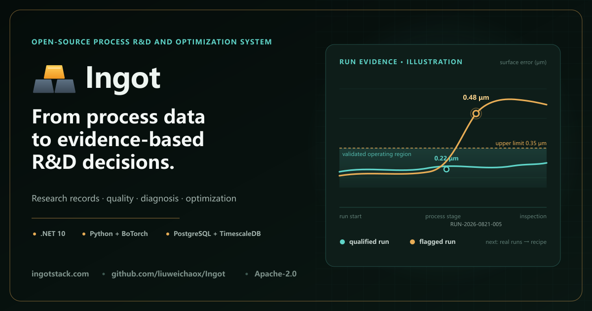
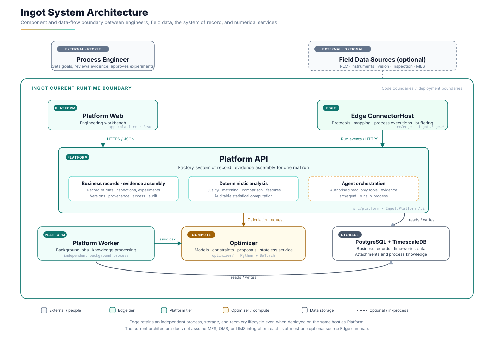

<a id="readme-top"></a>

<div align="center">
  <a href="https://ingotstack.com/en/">
    
  </a>

  <p><strong>Open-source Process R&amp;D and Optimization System</strong></p>
  <p>From process data to evidence-based R&amp;D decisions.</p>

  [](https://github.com/liuweichaox/Ingot/actions/workflows/ci.yml)
  [](LICENSE)
  [](https://dotnet.microsoft.com/)
  [](https://react.dev/)
  [](https://www.postgresql.org/)
  [](https://www.python.org/)

  [Website](https://ingotstack.com/en/) · [Documentation](https://docs.ingotstack.com/en) · [Report an issue](https://github.com/liuweichaox/Ingot/issues) · [Discuss](https://github.com/liuweichaox/Ingot/discussions)

  [简体中文](README.md) · English
</div>

<a href="https://ingotstack.com/en/">
  
</a>

<details>
  <summary>Table of contents</summary>

- [About the project](#about-the-project)
- [Getting started](#getting-started)
- [Usage](#usage)
- [Documentation](#documentation)
- [Roadmap](#roadmap)
- [Contributing](#contributing)
- [License](#license)
- [Contact](#contact)
- [Acknowledgments](#acknowledgments)

</details>

## About the project

Ingot is an Open-source Process R&D and Optimization System. Organize recipe versions, experiment records, and run evidence to support quality analysis, process analysis (including process diagnosis), and recipe optimization.

It serves R&D work with costly recipes, limited samples, and explicit quality objectives and safety boundaries. Engineers review actual conditions, process change, and quality outcomes in one place, compare eligible runs, and decide the next recipe inside those constraints. Recommendations are never dispatched to equipment.

The core chain is: run evidence → quality inspection → process analysis → next-recipe recommendation → engineer decision → outcome frozen from the later real run.

The repository claims only code, automated tests, and reproducible software behavior. Deployers evaluate applicability, safety, and realized benefit with their own data. See [Current status](docs/status.en.md) for what is implemented.

### Technology

| Part | Technology |
|---|---|
| Business services | .NET 10 |
| Engineering workbench | React 19, Vite |
| Data | PostgreSQL 17, TimescaleDB |
| Numerical optimization | Python 3.12 |
| Deployment | Docker Compose |

### Repository layout

| Path | Responsibility |
|---|---|
| `src/platform` | Business API, system of record, evidence assembly, and background work |
| `src/edge` | Field acquisition, semantic mapping, offline buffering, and replay |
| `src/agent` | Read-only analysis, knowledge retrieval, and evidence explanation |
| `src/shared` | Domain models and cross-module contracts |
| `optimizer` | Response surfaces, constraint checks, and sequential optimization |
| `apps/platform` | Engineering workbench |
| `apps/website`, `apps/docs-site` | Public website and documentation site |
| `tests`, `deploy`, `scripts` | Tests, deployment manifests, and architecture gates |

<p align="right"><a href="#readme-top">Back to top</a></p>

## Getting started

Choose an entry by objective:

| Objective | Path | Completion signal |
|---|---|---|
| Start locally | [Getting started](docs/getting-started.en.md) | Migration succeeds, services are healthy, and sign-in works; no external-system account or equipment connection is required |
| Inspect the acquisition demo | [Getting started](docs/getting-started.en.md) → [Semiconductor acquisition demo](docs/semiconductor-demo.en.md) | Observe synthetic run data move through the Modbus simulator into the workbench; this does not validate real equipment interoperability or field benefit |
| Evaluate the real-evidence workflow | [Current status](docs/status.en.md) → [Pilot guide](docs/pilot.en.md) | Check data admission using authorized real runs and reviewed quality outcomes |
| Contribute | [Contributing](CONTRIBUTING.en.md) | Install tools for the change area and verify it; the full gate is in the guide |

### Prerequisites

Trying the full stack requires Git, Docker Engine or Docker Desktop, and Docker Compose v2. That path does not require a local .NET, Node.js, or Python install.

Source development also requires .NET SDK 10, Node.js 22.22+, and uv 0.12.5. See [Contributing](CONTRIBUTING.en.md) for commands and engineering contracts.

### Installation

```bash
git clone https://github.com/liuweichaox/Ingot.git
cd Ingot
cp .env.example .env
```

Before startup, replace every `change-this-` placeholder in `.env`. Use a random database password. Set a separate random administrator password, or leave it empty so the first migration generates one. In PowerShell, replace the copy command with `Copy-Item .env.example .env`.

```bash
docker compose -f docker-compose.app.yml config --quiet
docker compose -f docker-compose.app.yml up -d --build
docker compose -f docker-compose.app.yml ps -a
```

After `platform-migrate` exits successfully and the database, API, Worker, Optimizer, and Web are healthy, open `http://localhost:3000`. Sign in with the administrator account in `.env`. If its password is empty, read the initially generated password with `docker compose -f docker-compose.app.yml logs platform-migrate`. Changing `.env` does not reset an existing account. See [Getting started](docs/getting-started.en.md) for complete instructions.

<p align="right"><a href="#readme-top">Back to top</a></p>

## Usage

After sign-in, publish a recipe version that defines variables and boundaries. Where field integration is configured, connectors automatically collect and semantically map actual settings, process trajectories, and run context; this is the preferred path for production evidence. Manually entered records or existing records from adjacent systems can also be linked. A run becomes an optimization observation only when trustworthy run facts and quality outcomes together pass admission.

The system proposes the next recipe inside safety boundaries and observed coverage. The engineer adopts it as the next-run correction, or turns a significant change into a revision draft; a later real run, parameter readback, and inspection record freeze the outcome once.

```text
Workbench
AI Assistant (Ingot Chat, separate investigation entry)
Field Operations → Run Records / Production Changeover / Tooling Installation / Inspection Tasks / Quality Deviations / Data Quality
Process Insight → Process Analysis / Process Materials / Mechanism Knowledge
Recipe Optimization → Recipe Versions / Adjustment & Validation
Configuration & Integration → Process & Quality / Field Integration / Production Resources
System Administration → Users, status, logs, raw events, and model services
```

This is the current workbench navigation, not a mandatory operating sequence. The daily business path is Field Operations → Quality Inspection → Process Insight → Recipe Optimization; Process Insight also provides process materials and mechanism knowledge. The user-facing boundary is a factory or independent production site, which also bounds data and authorization; the system identifies it internally with `SiteId`. Ingot Chat verifies authorized formal records and reviewed materials with source citations. It does not replace an engineer's decision or automatically change production parameters.

Field-equipment and enterprise-system connectors are optional source adapters. Without trustworthy run facts, the system does not produce a recommendation.

| Adjacent system | Boundary |
|---|---|
| MES, ERP, SCADA, historian | May supply run facts; does not replace MES scheduling, production execution, real-time monitoring, or real-time control |
| LIMS, QMS, ELN | May supply inspection and R&D context; does not replace laboratory, quality, sample, compliance, or document management |
| Statistical and optimization methods | Selected by data conditions; no single algorithm is the answer to every problem |
| Ingot Chat | Verifies authorized facts and reviewed process materials with source citations; does not generate numeric settings directly or control equipment |



Platform API is the system of record. Optimizer holds no business state. Agent reads facts only through authorized read-only tools. See [Production architecture](docs/production-architecture.en.md) for topology and the [Recipe-optimization pilot guide](docs/pilot.en.md) for the first recommendation.

<p align="right"><a href="#readme-top">Back to top</a></p>

## Documentation

Choose a reading path from the [documentation index](docs/index.en.md) or [online documentation](https://docs.ingotstack.com/en):

- **First use**: [Getting started](docs/getting-started.en.md) → [Recipe-optimization pilot guide](docs/pilot.en.md).
- **Understand the system**: [System design](docs/design.en.md), [Data model](docs/data-model.en.md), and [Analysis and optimization](docs/optimization.en.md).
- **Connect and operate**: [Data integration](docs/data-connection.en.md), [Production architecture](docs/production-architecture.en.md), and [Deployment](docs/deployment.en.md).
- **Connector demo**: [Semiconductor wafer etch acquisition demo](docs/semiconductor-demo.en.md) starts an independent Modbus TCP simulator and verifies 19 process values, 20 demonstration parameters, and a 300-second run path.
- **Assess fit**: [Current status](docs/status.en.md), [Scenario evaluation boundary](docs/rollout.en.md), and [FAQ](docs/faq.en.md).
- **Contribute**: [Contributing](CONTRIBUTING.en.md) and [Open-source dependencies](docs/open-source-dependencies.en.md).

Repository Markdown files are the documentation source; the documentation site publishes the same content. See [中文文档](docs/index.md) for Chinese.

<p align="right"><a href="#readme-top">Back to top</a></p>

## Roadmap

- [x] Record adoption, modification, rejection, and outcome freeze on the published recipe version
- [ ] Present run evidence completely: actual values, provenance, gaps, and quality review
- [ ] Explain recommendation admission and trace rejection reasons to run and quality records
- [ ] Constrain later recommendations with sourced, scoped, conflict-checked knowledge
- [ ] Make backup and restore, capacity, and alerting independently acceptable

Acceptance criteria are in the [Roadmap](docs/project-plan.en.md). Open work is tracked in [Issues](https://github.com/liuweichaox/Ingot/issues).

<p align="right"><a href="#readme-top">Back to top</a></p>

## Contributing

Contributions are welcome for equipment adapters, statistical methods, optimization, tests, and documentation.

1. Read [Contributing](CONTRIBUTING.en.md), the [Code of Conduct](CODE_OF_CONDUCT.md), and the [Security Policy](SECURITY.md).
2. Check [Issues](https://github.com/liuweichaox/Ingot/issues) or [Discussions](https://github.com/liuweichaox/Ingot/discussions) for duplicates. Describe the scenario and verification for a larger change first.
3. Open a pull request. Report vulnerabilities through [private reporting](https://github.com/liuweichaox/Ingot/security/advisories/new), not a public issue.

Run `./scripts/verify.sh` before submitting.

<p align="right"><a href="#readme-top">Back to top</a></p>

## License

Ingot is licensed under the [Apache License 2.0](LICENSE).

<p align="right"><a href="#readme-top">Back to top</a></p>

## Contact

- Website: <https://ingotstack.com/en/>
- Documentation: <https://docs.ingotstack.com/en>
- Issues: <https://github.com/liuweichaox/Ingot/issues>
- Discussions: <https://github.com/liuweichaox/Ingot/discussions>
- Security: <https://github.com/liuweichaox/Ingot/security/advisories/new>

<p align="right"><a href="#readme-top">Back to top</a></p>

## Acknowledgments

The README structure follows [Best-README-Template](https://github.com/othneildrew/Best-README-Template).

Runtime dependencies, licenses, and introduction rules are in [Open-source dependencies](docs/open-source-dependencies.en.md). Exact versions come from lockfiles and container manifests.

<p align="right"><a href="#readme-top">Back to top</a></p>
