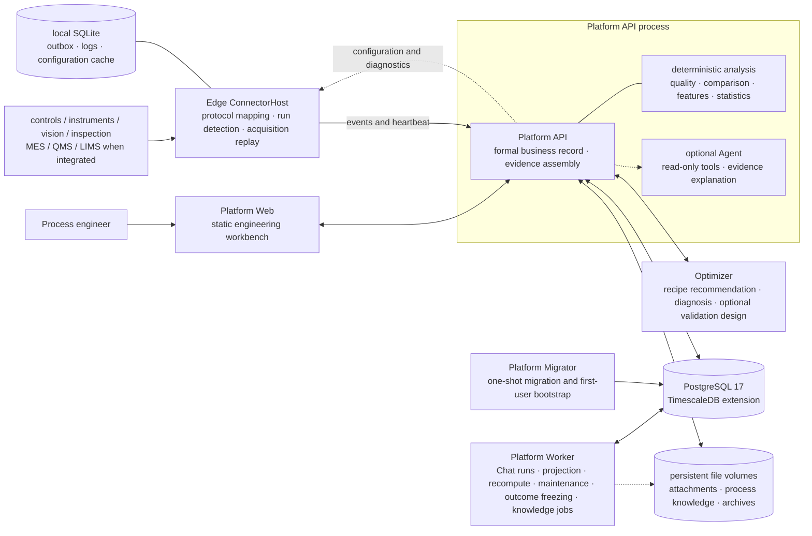

# System design

> Status: **v1 architecture baseline**. This document fixes product principles, business-record boundaries, and stable component responsibilities. Algorithms, default validation parameters, page layouts, and implementation sequence remain evolvable strategies.

This document defines component responsibilities, dependency direction, systems of record, runtime boundaries, and architecture constraints that may not be bypassed. Implementation changes are reviewed against this baseline and the automated architecture gates. See [Getting started](getting-started.en.md) for operating instructions.

## Design objective

Ingot's core value is fixed by the [Brand guide](brand.en.md): Organize recipe versions, experiment records, and run evidence to support quality analysis, process analysis (including process diagnosis), and recipe optimization.

Ingot is designed as a standalone R&D system. Its database, Web, API, and optimizer form its own runtime stack; recipe, run, and quality record keeping do not require external business systems. Field-device, enterprise-system, and cloud-service connectors are optional data sources. When a scenario has a reliable source, production evidence should preferably be acquired, semantically mapped, buffered, and replayed through a connector. Connectors must not become required dependencies of core R&D workflows, and Ingot does not replace MES, QMS, LIMS, scheduling, or equipment control. See [Current status](status.en.md) and the [Roadmap](project-plan.en.md) for implemented capabilities and planned work.

The architecture must therefore:

1. **Establish trustworthy facts first**: every analysis traces to experiment or run records with provenance, units, time, and version.
2. **Support engineering judgment next**: show differences, evidence, counterevidence, confounding, and uncertainty rather than only a score.
3. **Support independent R&D records**: R&D does not depend on production systems being online or field connectors being available; reliable field sources should be acquired automatically when available, while other sources retain provenance and review boundaries.
4. **Select methods by the problem**: statistics, response surfaces, machine learning, Bayesian optimization, and physical models are replaceable tools.
5. **Keep engineers in control**: engineers define objectives and safety boundaries and confirm the next recipe; the system never dispatches it automatically.

The system is designed to be self-hosted by one team and used by R&D and process engineers; production, quality, and equipment teams may collaborate.

## Product model

```text
Configuration and integration → Field operations → Quality inspection → Process analysis → Recipe optimization
```

This is the currently implemented production-evidence workflow: it organizes run data into trustworthy facts for analysis and recommendations. Next-recipe recommendations depend on completed production runs, inspection outcomes, and adequate coverage. Each run is an experiment: run records retain actual parameters and process trajectories, while quality records retain experiment outcomes. See [Current status](status.en.md).

In the rest of this document, “site” means the factory or independent production site shown to users; APIs, the database, and deployment configuration continue to use `SiteId` as the technical identifier.

The current Web information architecture balances the decision chain with frequent role-based tasks through business groups rather than making every page a first-level entry:

- **Workbench**: prioritized quality tasks, run status, field status, and R&D progress;
- **Ingot Chat**: a separate entry for verifying authorized structured facts and reviewed materials;
- **Field operations**: production runs, production changeover, quality inspection, quality deviations, sampling and run-completeness checks, and tooling installation when a scenario needs tooling traceability;
- **Process insight**: process analysis, process materials, and mechanism knowledge;
- **Recipe optimization**: recipe versions, adjustment and validation, engineer decisions, and later real-run outcome freezing;
- **Configuration and integration**: process variables, analysis rules, inspection definitions, quality plans, acquisition setup, Edge nodes, and tooling configuration when the scenario needs tooling traceability;
- **System administration**: users and permissions, system status, logs, raw events, model services, and assistant evaluation for administrators.

Raw events reported by Edge nodes belong to system administration, where platform administrators audit them and troubleshoot integration.

A recipe version's launch check covers only that version's own dependencies: the recipe version and its referenced process variables are published; a published acquisition setup references the same process-variable version and maps every control parameter and process quantity; a published analysis plan references the same process-variable version and includes process curves; and a published quality plan covers the version's product scope with a numeric characteristic that has a unit and acceptance range.

When every check passes, production changeover selects that version, and new runs are acquired, analyzed, and judged against it. Each run has fixed trace sources for equipment and run identity, product and recipe, material lot, process fields, and quality outcomes; tooling is linked when the scenario needs tooling traceability.

The menu order reflects the daily use path rather than first-time deployment order: review field operations and quality first, then process insight and recipe optimization. A new scenario still defines and publishes process semantics before mapping real sources to those semantics. The next adjustment, the engineer decision, and outcome freezing are completed on the published recipe version: a small adjustment does not create a version, while a significant change creates a revision draft. See [Current status](status.en.md).

Recipe versions are the common source of experiment parameter settings. Parameter codes, names, data types, units, bounds, and steps come from the referenced process variables; recipe versions retain settings, revision reasons, and evidence. No separate form may redefine parameters. All parameters are analysis variables; optimization changes still respect data types, change-allowed flags, and safety bounds.

System administration is a separate entry and does not compete with business tasks for navigation priority. Secondary navigation places frequent daily tasks before setup and maintenance actions. Before the first production release, use canonical current URLs; removed erroneous pages may redirect to existing business entries so already-open links cannot continue exposing the wrong workflow. After production release, URLs and data contracts follow controlled version-migration discipline.

Menus may change, but these business facts must not be hidden, duplicated into parallel records, or buried inside algorithm state.

## System map



Code-project boundaries are not deployment boundaries. Current long-running units are Platform API, Platform Worker, independent Edge ConnectorHost instances, PostgreSQL/TimescaleDB, Optimizer, and Web; Migrator is a one-shot job completed before API and Worker start.

Chat admission and queries run with Platform API, while Platform Worker executes durable deterministic-analysis and optional model-Agent jobs; Agent remains a code library rather than an independent service. Inspection attachments and process knowledge use persistent file volumes while metadata and formal state remain in PostgreSQL.

A small site may share a physical server, while Edge and Platform retain independent processes, storage, identity, and recovery lifecycles.

This document fixes stable business boundaries. [Production architecture](production-architecture.en.md) defines the target topology for replicas, failure domains, data lifecycle, disaster recovery, and controlled action; [Deployment](deployment.en.md) defines current operating procedures. The target design must not be presented as a capability already delivered by the current Compose topology.

## Stable component responsibilities

### Edge

- Actively connect to controls, instruments, gateways, and approved business sources.
- Map vendor addresses, protocol types, and raw units to stable business codes.
- Detect run boundaries and report actual settings, process samples, events, and context provenance.
- Use a durable local queue for outages, platform restarts, and short backpressure.
- Pull versioned acquisition configuration, validate it locally, and report applied state.

Edge does not decide process causes, run product-level optimization, or become the formal record for recipe decisions and quality outcomes.

Discrete run identity must remain traceable across ConnectorHost restarts. If the connector starts while equipment is already active and no recoverable shop-floor run identity exists, Edge marks the segment as incomplete instead of presenting it as a complete run from a normal start. A single event deterministically rejected by Platform is quarantined with a local audit record and must not block later valid events.

### Platform

- Store industrial objects, equipment, manufacturing context, process executions (runs), inspections, optimization tasks, recipe recommendations, engineer decisions, evidence, and knowledge.
- Maintain versioned configuration, provenance, units, permissions, audit, and business state machines.
- Assemble the conditions, trajectory, and result of a real run into an immutable analytical observation.
- Execute data-quality, matching, comparison, feature, and reviewable statistical calculations.
- Admit inspection evidence to formal comparison and optimization only when it matches a published quality plan, has trusted identity, and satisfies independent-review requirements; versioned definitions determine non-numeric outcomes on the server.
- Preserve inputs sent to numerical services and their returned results.

Platform is the formal business system of record. Next-recipe recommendations, engineer decisions, execution links, and quality outcomes are independent append-only records; they do not reuse a run-plan or equipment-command state machine and cannot exist only in Optimizer, Agent, or a browser.

Chat uses `ChatConversation` and ordered `ChatMessage` records as its formal user-facing conversation model. URLs, history lists, refresh recovery, idempotent sends, and deletion are scoped to a Conversation. A user message and its pending assistant message are created in one transaction, while `ClientMessageId` prevents network retries from duplicating messages. `AgentRun` is only the execution detail behind an assistant message and retains plans, tool calls, model usage, and stream events; it does not define conversation identity.

The production host stores Agent run snapshots and event streams in Platform PostgreSQL. Agent core still depends only on `IAgentRunStore` and does not reference Npgsql. After the message transaction commits, API only creates a queued run; an independent Platform Worker claims, renews, and executes it through a database lease. Restarting API does not lose an accepted answer task, and a later Worker instance can reclaim an expired lease after interruption. A continuing conversation assembles only bounded summaries, findings, and limitations from recent completed answers instead of feeding unbounded charts, proposals, or old record references back to the model; an old answer also cannot replace a production-data query required by the current question.

Platform separates policy from implementation by use case: `Platform.Application` owns database-independent ports plus multi-step rules and use cases for process research, acquisition configuration, manufacturing context, events, identity, insight, analytics, and inspection. `Platform.Infrastructure` implements PostgreSQL transactions, external services, background hosts, and cross-context adapters through module-specific composition entry points.

New business controllers handle transport and authorization, then delegate business operations through Application use cases. A small set of operational adapters for Edge registration/diagnostics, identity, and runtime metrics still injects Infrastructure services directly into API; `ARCH-001` below constrains this gap, which must not expand into new business-write paths. Migrator bootstraps the first local user under a transactional lock, and Worker owns periodic maintenance.

Concurrency idempotency and atomic writes remain enforced by database transactions and constraints rather than being lifted into in-memory rules. Process-research rules cannot read the inspection module directly; inspection, process-run, and configuration evidence becomes optimization observations only through explicitly registered assembly adapters (currently `ResearchObservationAssembler`).

### Architecture debt register

| ID | Current gap | Owning boundary | Expansion prohibited | Exit criteria | Trigger |
| --- | --- | --- | --- | --- | --- |
| `ARCH-001` | A small set of API controllers for Edge registration/diagnostics, identity, and runtime metrics directly inject Infrastructure services | Platform composition root | No new business-write path and no domain rule in controllers | Add Application ports for the existing operational use cases; remove the corresponding Infrastructure namespace references from API; cover the rule in architecture checks | Before the first production pilot or before adding a second production maintainer, whichever comes first |

`ARCH-001` is not a permanent exception. Any feature change touching these controllers must reduce the registered scope or demonstrate in its change notes that the dependency surface did not expand.

### Optimizer

- Receive the complete optimization definition, valid real-run observations, pending recommendations, and a random seed.
- Execute reproducible numerical modeling, constraint checks, and candidate selection.
- Return predictions, uncertainty, feasibility, parameters, rationale, and model version.
- Remain free of business state, never access equipment directly, and never confirm or dispatch recipes.

### Agent

- Parse the engineer's question and current business context.
- Call authorized read-only or controlled business tools.
- Organize facts, cite sources, explain limits, and suggest next steps.
- Never compute or invent numerical process settings itself and never turn language probability into an engineering conclusion.

Agent uses two separate evidence paths. Structured production facts such as runs, inspections, configuration, and optimization always come from authorized business tools. Document knowledge such as SOPs, manuals, reports, and engineering notes is retrieved only from reviewed sources and fragments inside the authorized site. Retrieval first filters by site authorization and review status, then by applicability: with an explicit recipe it includes site-wide material and material scoped to that recipe; without a recipe it includes only site-wide material. PostgreSQL combines full-text and similarity matching with optional semantic-vector ranking, returning fragment-level source, page or sheet, source SHA, and content hash. When semantic embeddings are disabled, unavailable, or fail for a query, retrieval falls back to keywords. Retrieved material is read-only evidence for an answer; it cannot replace a current production-data query, establish root cause, or modify equipment.

### Web

- Organize engineering work around business objects, runs, inspections, and optimization tasks.
- Present facts, data quality, evidence, and actionable steps together.
- Avoid browser-local business state that conflicts with Platform.

## Evidence spine

An analyzable run must answer:

```text
who / which equipment / which product
        + actual recipe version and controlled conditions
        + process trajectory and stages
        + material, tooling, lot, and other context
        + quality and safety outcomes
        + provenance, time, units, and versions
```

Stable identifiers connect these facts:

- `ExecutionId`: the shared run identity generated by Edge and used by Platform to correlate process execution and field events;
- `ExecutionKey`: the association between a next-recipe recommendation record and real execution;
- `EquipmentId`, product/process object, and recipe version number: minimum run identity;
- planned and actually applied recipe versions remain separate, and comparable cohorts use the actual recipe version dimension declared by the analysis plan;
- content hash: the fixed analytical input and its provenance.

Identifiers may be mapped but never inferred after the fact. Unlinked runs remain visible with a reason rather than disappearing silently.

## Manufacturing context

Equipment, material, tooling, lot, calibration, and maintenance state may be important causes or may only be useful for traceability. The system does not assume their effect in advance.

Every run preserves an immutable context snapshot. Versioned scenario configuration classifies fields as:

- **required for analysis**: absence excludes the run from a specified analysis;
- **record when available**: retain for traceability, stratification, and later coverage assessment;
- **validated for modeling**: sufficient, reviewable real-run evidence supports use in diagnosis, optimization, or applicability scope.

The system must expose coverage, missingness, sample counts per level, and factor overlap. Data without overlap cannot pretend to separate equipment, mold, or material effects.

## From observation to cause

```text
comparable runs → differences and first deviation → candidate cause
                                                     ↓
                                  counterevidence / confounding / missing data
                                                     ↓
                                  continued real-run evidence → support / reject / inconclusive
```

- Observational analysis may report differences, associations, and candidate causes.
- Every candidate cites source runs, comparison baseline, analysis version, and limitations.
- Only controllable or blockable candidates can automatically become investigation drafts.
- Causal promotion requires appropriate controls, repetition, blocking, randomization, or intervention evidence.
- When identification conditions are absent, “insufficient evidence” is the correct result.

Specific statistics and models are described in [Analysis and optimization](optimization.en.md) and are not immutable architecture.

## From real runs to the next recipe

Daily recipe optimization consumes completed real production runs directly:

```text
actual recipe + process context + valid quality outcome
                         ↓
              optimization observation
                         ↓
 next-recipe recommendation inside safety and observed coverage
                         ↓
       engineer confirmation through the existing production flow
```

A production run requires no engineer reclassification. The next-version proposal is opened from the published recipe already in view. Site, product, equipment, adjustable parameters, and the numeric quality objective come from that version, its process variables, the quality plan that covers it, and the runs already completed on it. Once at least three valid runs covering two distinct actual recipes pass admission, the system may create one independent append-only recommendation. It retains the input snapshot, prediction, uncertainty, evidence scope, and rationale. Before persistence, recommended parameters snap to the process-variable step and are checked against observed coverage; the rationale shown to engineers is in Chinese.

Engineers then append adoption, modification, or rejection and its reason. Adopting a next-run correction agrees to run those settings on the current published version. It publishes no new version and does not download setpoints to equipment. The next completed run of the same recipe version that starts after the decision attaches automatically, and parameter readback plus inspection results freeze the outcome. When an engineer treats the change as significant, the suggested settings open that version's revision draft. The published version stays as it is until the draft is published. A recipe version does not open a second correction while one is still unfrozen. Rejection, expiry, or a frozen outcome is what allows another correction from the newer runs.

## Recipe recommendation architecture constraints

This section defines mandatory constraints for next-recipe recommendations, mechanism knowledge, and process knowledge. `scripts/verify-architecture.sh`, `scripts/verify-product-scope.sh`, and backend tests guard them.

### Ownership and records

The business scope for next-recipe recommendations and mechanism knowledge is “factory/production site + recipe”; process-knowledge sources are authorized by factory/production site and may optionally have recipe-specific applicability. The system expresses this scope internally with `SiteId` and the recipe identifier. Recipe applicability is not an authorization boundary; site access remains the security boundary for reading sources and fragments.

| Record | Ownership key | Only write path | Mutability |
| --- | --- | --- | --- |
| Next-recipe recommendation | site + recipe + input hash | `ResearchOptimizationService` | Append-only; freezes the brief and its hash; expires after 24 hours |
| Engineer decision | recommendation + item | `ResearchRecipeRecommendationDecisionService` | At most once per item |
| Execution link | decision; actual execution key is globally unique | `ResearchRecipeRecommendationDecisionService` | At most once per decision, recording who linked it |
| Frozen outcome | decision | `ResearchRecipeRecommendationDecisionService` | At most once per decision, computed from source data, recording who froze it |
| Mechanism claims and conflicts | site + recipe | `MechanismKnowledgeService` | Content appends by version; status transitions are recorded |
| Process-knowledge source | site + content SHA-256 | knowledge-source registration | Immutable content and applicability scope; searchable only after review |

Within a site, one content hash maps to one source record and one scope selector. A site-wide source can be used with any recipe at that site; a recipe-scoped source applies only to its matching recipe. Re-uploading cannot change an existing source's scope. If the same content is already registered under another scope, upload conflicts so the source can be reviewed or revised first. Searches without recipe context return only site-wide sources; recipe-scoped material is never treated as evidence for another recipe.

### Invariants

1. **Frozen brief**: `RecipeRecommendationBrief` contains only the site, recipe, quality objectives, adjustable parameters and bounds, parameter and outcome constraints, derived features, and context scope. `RecipeRecommendationBriefPolicy` normalizes it and validates it against the published recipe at generation time; it is stored with `BriefHash`. Recording a decision, linking a run, and freezing an outcome all recompute the hash and reject any mismatch.
2. **Parameters come only from the recipe**: adjustable parameters must be change-allowed numeric parameters in the process variables referenced by the selected recipe version, with matching units and bounds inside the process-variable range.
3. **Observation scope comes from the brief**: observation assembly admits only completed runs inside the brief's site, recipe, and context scope (product family, product, equipment, recipe version, output item, and lookback days).
4. **Pending points share the brief**: only accepted or modified decisions with the same site, recipe, and `BriefHash` and without a frozen outcome are sent to Optimizer as pending points.
5. **One-way decision chain**: recommendation → decision → execution link → outcome is append-only and never moves backward. Expired recommendations accept no new decisions; rejection is terminal; a linked run must belong to the recommendation's site, start after the decision, and fall inside the brief scope.
6. **Mechanism knowledge stays in scope**: claim variables must come from that recipe's process variables; applicability may use only site, recipe, product, and equipment dimensions; evidence may come only from same-site knowledge sources or fragments, or frozen recommendation outcomes for the same site and recipe; conflicts are recorded only inside one scope.
7. **Knowledge search follows site and applicability scope**: the assistant must resolve one authorized site before searching process knowledge or return insufficient evidence. With an explicit recipe, search only site-wide sources and sources scoped to that recipe; without one, search only site-wide sources. Applicability does not replace site authorization.

### Dependency direction

- `Ingot.Contracts`: data contracts for briefs, recommendations, decisions, and outcomes, with no implementation dependency;
- `Platform.Application`: `RecipeRecommendationBriefPolicy`, `ResearchOptimizationService`, `ResearchRecipeRecommendationDecisionService`, `RecipeRecommendationQueries`, `RecipeKnowledgeScopeReader`, `MechanismKnowledgeService`, and storage ports, with no reference to Npgsql, HTTP clients, or the inspection module;
- `Platform.Infrastructure`: PostgreSQL stores, `ResearchObservationAssembler`, and the optimizer client; the assembler is the only path for inspection, run, and configuration evidence to enter recommendations;
- `Platform.Api`: `RecipeRecommendationsController` handles only transport, identity resolution, and site authorization; rule conflicts return 409 and optimizer unavailability returns 503;
- Web: the published recipe version submits the brief directly and keeps no recommendation state in the browser. Adopting a small correction does not create a version; a significant change uses that version's revision draft.

## Consistency and replay

- The same analytical input produces a stable content hash.
- Data, features, analysis methods, models, and scenario configuration carry versions.
- Decision outcomes are calculated from source data rather than accepted as trustworthy self-assertions.
- Concurrent requests and retries do not create duplicate recommendation, decision, execution-link, or outcome records.
- Historical data remain interpretable under their original versions and recomputable under new versions.
- Optimizer or Agent failure does not stop acquisition, run records, or inspections.

## Scenario replacement boundary

A new process scenario provides:

- industrial objects, equipment, and run boundaries;
- controlled variables, actual-value sources, units, and allowed ranges;
- process signals, stages, and versioned features;
- quality objectives, inspection mappings, and safety constraints;
- required and optional context fields;
- a safe baseline, default recommendation policy, and optional mechanism knowledge.

It should not rewrite run identity, evidence relationships, execution state machines, audit principles, or the stateless Optimizer protocol. Generality is supported only after a second, materially different real scenario works without changing those contracts.

## Agent capability and interoperability boundary

Agents do not depend directly on internal Platform CRUD and do not gain business permission merely because MCP, OpenAPI, or an SDK is used. The interoperability adapter handles discovery, schemas, and invocation. Platform continues to enforce site isolation, evidence citations, state transitions, approval, idempotency, audit, and rollback.

HTTP errors use `application/problem+json` with a stable `code`, request `traceId`, and standard `detail` field. Monotonically growing histories such as recipe-recommendation flows use opaque cursors and bounded `limit` values; external implementations must not depend on unbounded arrays.

Capabilities open progressively by risk:

- **Read**: query authorized runs, evidence, quality, context, and applicability.
- **Propose**: create investigation drafts or mechanism-claim drafts without changing formal state.
- **Commit**: freeze a version and submit independent approval; creators cannot self-approve.
- **Execute**: invoke only allow-listed, time-bounded, scoped, stoppable, reversible actions.

The current Agent exposes authorized read-only analysis tools, does not connect to devices, and has no business-write permissions. Proposal, commitment, and execution above describe risk levels for conditional extensions, not a list of existing tools. Any future equipment action requires a separate safety-engineering project: Platform would retain authorization records, a controlled integration or Edge gateway would execute the action, and actual confirmation and outcomes would return to the formal record. See the [Roadmap](project-plan.en.md) for scope and prerequisites.

## Evolvable strategies

The following record current choices but do not define the product core:

- Web navigation and page layout;
- protocol drivers and equipment templates;
- feature algorithms, statistical tests, and surrogate models;
- default repetitions, blocks, and stopping rules;
- GP variants, acquisition functions, physical priors, and transfer methods;
- LLM providers, model roles, and prompts;
- agent-protocol adapters such as MCP, OpenAPI, and SDKs;
- implementation sequence and priorities.

These strategies follow real data, engineer feedback, and field validation. Stable-boundary changes are recorded through ADRs.
